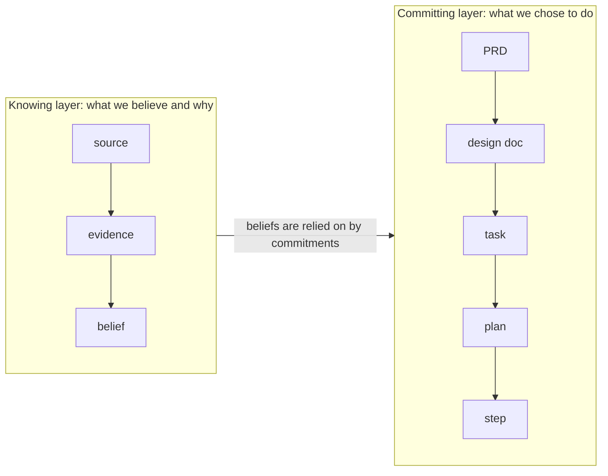
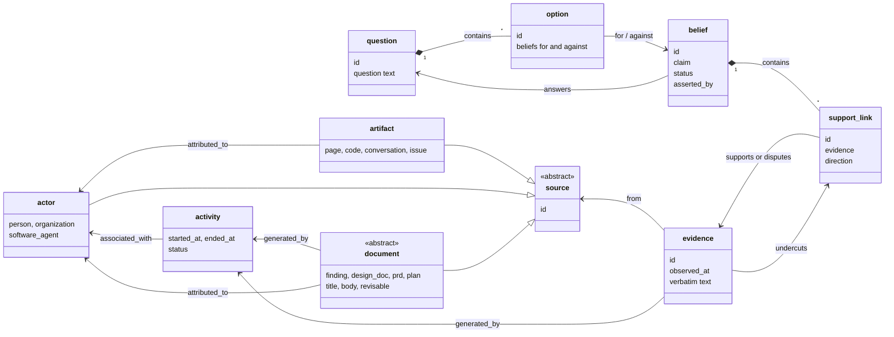
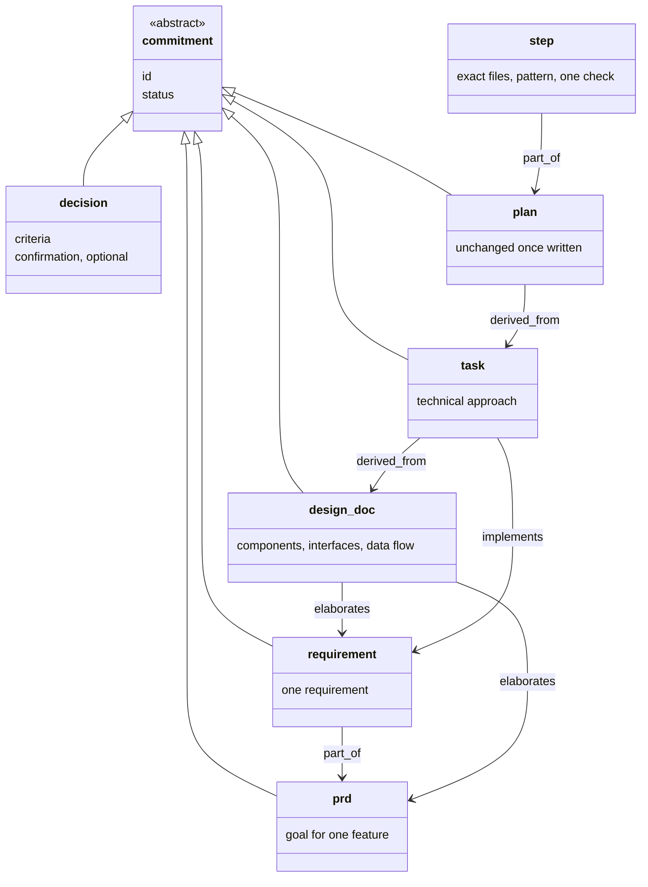
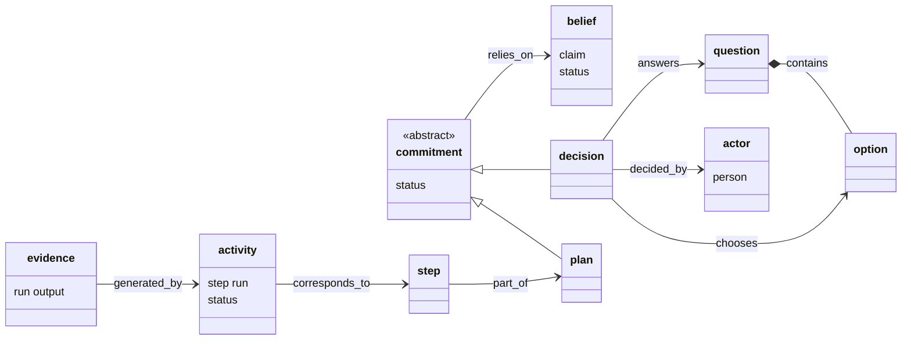
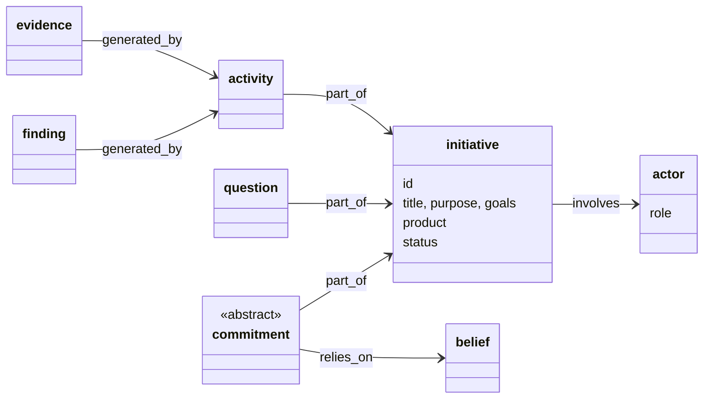

# Context graph design, part 1: the model

## Why this exists

AI agents doing real work need the right context at the right moment: what we know, why we believe it, what we've decided, and what's in flight. Today that context lives in hand-kept notes that go stale, mix everything together, and rely on someone remembering what matters.

This design replaces those notes with **small, typed, linked records**. Its value:

- **Every reader gets just what they need.** Context is assembled per reader by following links, not by reading everything.
- **Every claim can be traced** back to the evidence and source behind it.
- **When something turns out wrong, the system knows what it touches**, and reopens only that.
- **It stays quiet.** Most changes are handled by agents; a person sees only proposals worth their attention.
- **Work survives interruption.** Any agent can pick up where another left off, from the records alone.

Part 1 covers the model: the kinds of records, how they link, and the principles behind them. How the records live on disk, and how today's initiative folders move onto the model, come in later parts.

**How to read this.** Sections 1–2 give the idea in about five minutes. Section 3 is the object model, with diagrams. Section 4 sets out the principles, and section 5 walks one example through the model and the principles together. Section 6 sums up the naming rules and the ID scheme, and section 7 says where the ideas came from. Section 8 lists how the model is meant to grow, and section 9 what later parts cover. The appendix is a glossary to come back to.

## 1. The problem

Context has **readers** and **moments**: an agent starting a session, an implementer building a task, a reviewer checking a change, a person coming back after a break. Each reader at each moment needs something different. Some must *not* see certain things: a reviewer shouldn't see the author's reasoning, and a small implementer model should see almost nothing beyond its one step.

A single free-form notes file can't serve all of them. It goes stale, mixes current state, resume pointers, patterns and parked drafts in one blob, and everything else is found by searching and reading whole files.

So we need records that are small, typed and linked, so that context can be assembled per reader by following links instead of relying on memory.

## 2. The idea in one picture

The model has two layers.

- The **knowing layer** records what we believe and why. A *source* (a person, an AI agent, a document made outside our records or one we wrote) gives us *evidence* (a verbatim quote or observation), recorded during an *activity* such as an agent's session. Evidence supports *beliefs* (claims we currently hold). Gaps are *questions*, each with *options* for answering it.
- The **committing layer** records what we chose to do: a PRD (product requirements document) and its requirements, decisions, a design doc, tasks, and plans broken into steps. These are **commitments**: they aren't true or false; they're chosen.

The main bridge between the layers: a commitment **relies on** its **load-bearing** beliefs, the ones that would change it if they turned out wrong. Its author names them, and only them, when writing it. (Decisions also answer questions, and runs of a plan's steps are recorded as activities; section 3.3 shows every crossing.)



Arrows here show **which way a change travels**. (The links stored in records point the other way, from the newer record to what it was built on; see section 3.)

How a change flows:

1. **New evidence arrives.** Evidence itself never changes; we only add more.
2. **A belief is re-checked.** If the new evidence shows the claim is false, the belief becomes `incorrect`. If it only weakens the support, the belief may become `insufficient`, or nothing happens.
3. **Invalidation travels up.** When a belief falls, find the commitments that named it as load-bearing. Revise at the highest affected level.
4. **Staleness flows down, one step at a time.** What was built directly on the revised commitment is re-checked. A record that comes out equivalent just re-pins, and the check goes no further. Only a record that actually changes passes the check on to what was built on it.

All of this must be **quiet**: most changes are handled by agents and never reach a person.

## 3. The object model

Four diagrams: the knowing layer, the committing layer, the bridge between them, and initiatives. The naming rules and ID scheme are summed up in section 6, and every term is defined in the appendix. Plain arrows are edges, pointing the way each is stored: from the newer record to what already existed (a sub-record added later, such as a new support link, counts as new), labeled with the exact edge name. Two arrow styles aren't edges: a hollow triangle means "is a subtype of", and a filled diamond means "stored inside". A `supports or disputes` label is a support link's `direction` value; an option's links to beliefs are `for` or `against`.

### 3.1 Knowing layer



Walk-through:

- A **source** is an **actor** (who acts), an **artifact** (what was made outside our records) or a **document** we wrote. `source` is an abstract shape, never stored as a type: the source's kind is its record type. An artifact is `attributed_to` the actor that made it.
- **Evidence** comes `from` a source. It holds the verbatim text and when it was observed.
- An **activity** is something that happened, such as an agent's session. Evidence is `generated_by` the one activity that recorded it, and the activity is `associated_with` the actor responsible. So every piece of evidence answers both *who said it* (`from`) and *which run recorded it* (`generated_by`).
- A **document** is prose we wrote: a title and a body, revisable with old revisions left in git, `generated_by` the one activity that created its first revision and `attributed_to` the actor who wrote it. It is an abstract shape, like `commitment`, and is never stored as a type itself. When a belief is drawn from a document, the evidence quotes it (`from` the document, at a pinned revision that doesn't seal it, so the document stays free to edit), so the quote stays verbatim if the document is later corrected. A quote lets you revise the quoted revision but doesn't force it: sealed means you must revise, quoted means you may. If the quoted text is edited in place, `validate` warns; `mason revise` (after undoing the edit) keeps the quoted revision, the quote keeps naming it, and the warning clears.
- The document types are the **finding** (the knowing layer's document: a survey, an analysis, an observation) and, in the committing layer, the design doc, PRD and plan. A finding needs no edges or status until a belief is drawn from it (nothing can rely on a finding directly), so ideation stays free. Only load-bearing beliefs are drawn out of a document; the rest stays prose. Decisions and tasks are not documents: a decision isn't quoted until a real case needs it, and a task says what to do.
- A **belief** holds a claim, a status, and who asserted it. Its **support links** live inside its record. Each link points at one piece of evidence and says `supports` or `disputes`. Because each link has its own ID, an undercut can target exactly one link.
- A **question** holds its **options** inside its record. Each option links to beliefs for and against it, shaped like a belief's support links. A belief can also answer a question directly (`answers`).

Edges not drawn, to keep the picture readable:

| Edge | From → to | Meaning |
|---|---|---|
| `acts_for` | actor → actor | Today, a software agent acting for a person. |
| `undermines` | evidence → evidence | The newer observation shows the older one was unreliable. |
| `questions` | question → any record | The question was raised about that record (decisions included). |
| `about` | evidence → any record | What the evidence is about. |
| `mentions` | any → any | A reference only. **Never** a dependency, so it never causes a re-check. |

`support_link` and `option` are sub-record types: each lives inside its parent's record and has its own ID, so edges can point at it.

### 3.2 Committing layer



Walk-through:

- The pipeline runs **PRD → design doc → tasks → plan → steps → implement → review**.
- A **requirement** is `part_of` a PRD. A **design doc** `elaborates` the PRD or its requirements. A **task** `implements` requirements and is `derived_from` the design doc.
- `derived_from` links a commitment to what it was built from: a task to the design doc, a plan to its task. Staleness flows down it, and also down `part_of`, `elaborates` and `implements`: revise a requirement and the design doc and tasks built directly on it are re-checked. Each re-check either re-pins (still holds) or makes a new revision, and only a new revision passes the check further down.
- One task has one **plan** (`validate` warns when a task has more than one in force). A plan is `part_of` its initiative, like every commitment; it has many **steps**, each `part_of` the plan. A task is the unit that ships (outcome criteria, reviewed). A step is the unit a small model executes.
- `status` is the maturity status. Every record shown under `commitment` carries one; steps don't.
- Some fields live only in the schema (part 3): a task's `progress` (todo, in progress, blocked, done) and `blocked_by`, a question's `dropped` text (having it means the question was dropped), an activity's `session`, and the `role` on `involves`.

Edges not drawn:

| Edge | From → to | Meaning |
|---|---|---|
| `follows` | step → step | Step order. |
| `supersedes` | decision → decision | Replaces the older decision. |
| `amends` | decision → decision | Changes part of the older decision; the older one stays accepted. |
| `revision_of` | revision → previous revision | `X@rN` is a revision of `X@r(N-1)`; both are versions of record X. Implied by the ID (section 6), so not stored. |

### 3.3 The bridge



Walk-through:

- **`relies_on` is the bridge.** A commitment names the beliefs it rests on, and only those. This is where invalidation crosses from knowing to committing.
- A **decision** `answers` a question and `chooses` one of its options. A *leaning* is just a decision with status `leaning`. A decision is `decided_by` an actor, and can record who it `consults` (asked before deciding) and `informs` (told after). Today the decider is always a person; because the edge points at `actor`, an organization or a trusted software agent could decide later without changing the model. A new question can point at a decision with `questions`.
- **`validate` warns about a decision that contradicts itself or its neighbours:** `chooses` names an option of a question the decision doesn't `answers`; two decisions in force settle one question; or a decision `supersedes` another that isn't `superseded`.
- **A question is open until an answer settles it.** An accepted decision settles it, and so does a held belief. While a decision answering it is `proposed` or `leaning`, the question stays listed with the answer waiting, whatever else answers it. A dropped question isn't listed.
- **Progress is recorded as runs.** Each run of a step is an `activity` that `corresponds_to` the step, with a status (`completed` / `failed`). What it produced (test output, the commit) is evidence `generated_by` that run. This is the second place the layers meet: what happened (knowing) points at what was planned (committing). The plan itself never changes.

Why options sit on the question, not the decision: a decision rests on beliefs about why the chosen option works *and* why the others lost. On the question, the beliefs behind each option are visible. With options as free text inside a decision, that dependency would be invisible.

### 3.4 Initiatives



Walk-through:

- An **initiative** is one planning effort: a feature, a product's next phase, a learning effort. It records its title, purpose and goals, optionally the product it targets by default, and the actors `involved` in it, each with a role (decides, consulted, interested). An actor's interest in an initiative is `involves` with role `interested`.
- **Work belongs to an initiative; knowledge doesn't.** Commitments, questions and activities are `part_of` one. Evidence, beliefs, sources and findings are reached through what relies on them or the activity that produced them. A finding or a piece of evidence is `generated_by` the session's activity, and that activity is `part_of` the initiative, so the trail from knowledge to initiative goes through the activity. That trail answers "what did this initiative learn", and a belief formed in one initiative can carry another without being copied. The activity is attached automatically when the record is created (part 3, section 6).
- An initiative is a record, not just a saved search, because its goals and scope need a home. It is not folded into a PRD either: a learning effort has no product and no PRD. A product initiative usually has a PRD `part_of` it.
- Its README is generated from the records linked to it, never edited by hand. "Where are we" is a query, `mason where`, not a page.

## 4. Principles

**Evidence never changes.** Evidence is a dated, verbatim quote or observation, never a paraphrase. Its fingerprint is recorded by the first `mason sync` after it is written, and `validate` fails if it changes. Corrections come as *new* evidence (an undermine), so the record of what was observed stays trustworthy. A reproduction is new evidence too, with its own record.

**"Someone said X" is evidence that they hold X, not evidence that X.** Beliefs drawn from a person's words rest on that person's authority, and that should be visible. `asserted_by` shows whether a person confirmed a belief or an agent made it. People confirm only the load-bearing beliefs drawn from their own words, and those arrive as proposals, not flags.

**Only a rebut makes a belief incorrect.** Undermines and undercuts remove support without saying the claim is false. They lead to a quiet re-check, and a belief becomes `insufficient` only if too little support remains. A query lists the beliefs whose support was undermined or undercut, and the commitments relying on them show in the re-check list. The quiet re-check writes evidence and sets `via` on the commitment's `relies_on` pin; once that evidence was observed on or after every undermine or undercut, the doubt clears, and a newer undermine brings it back. Only `supports` links count. Incorrect and insufficient need different responses: revise, or gather more evidence.

**Commitments name their load-bearing beliefs, and only those can reopen them.** The author knows what's load-bearing at writing time; inferring it later over-links. Likewise, only load-bearing beliefs are pulled out of documents as records; the rest stay in the document. A hidden assumption found during implementation becomes evidence, and the next revision lists it. This is the strongest quietness tactic so far.

**The system must be quiet.** Flag fatigue is real: a stream of "this might be stale" warnings is exhausting, and people learn to clear them unread. A citation isn't a dependency, so `mentions` never raises anything. A re-check that finds nothing changed re-pins and stops (early cutoff); since an agent re-deriving a record almost never produces identical text, "still holds" is a judgement, not a text comparison. Non-breaking revisions re-pin quietly. Leanings change without alarms.

**Settle late, visibly.** Every commitment carries a maturity status. `leaning` records "tentatively agreed, expected to change", so early churn stays quiet. Settling becomes a visible move from `leaning` to `accepted`, and it also seals: once a decision is accepted its current revision can't be edited in place, so changing its meaning takes a new revision. The same holds for a question once it is settled and for a step once its plan is accepted (part 3, section 5). Without `leaning`, a tentative yes has to be recorded as either `proposed` (too weak) or `accepted` (too strong).

**Invalidation travels up; staleness flows down.** When a belief falls, revise at the highest affected commitment, then re-check what's below it, one step at a time. Revisions are made only for changes of substance, so status changes never start staleness (a belief's status does start invalidation). A propagating link from a commitment in force to a target that is closed (`rejected`, `deprecated`, `superseded` or, for a belief, `withdrawn`) is reported as needing a re-check, like a stale link. Revising fixes the same record; replacing it with a different one is `supersedes`.

**Resumable from files, not sessions.** Work must survive an interruption at any pipeline stage without session restore. Each green step is committed, so git is the checkpoint. A plan's content stays unchanged once written; progress is recorded as runs and the evidence they produce. Resuming means reading the plan plus the latest run of each step, re-running the last passing check, and continuing.

**Work belongs to an initiative; knowledge doesn't.** Commitments, questions and activities are `part_of` an initiative. Evidence, beliefs, sources and findings outlive the effort that formed them, so they belong to none and are reached by following links: a finding or evidence is `generated_by` a session's activity, which is `part_of` the initiative. This keeps knowledge reusable across initiatives without copies.

**Store each relation once; newer points at older.** The author writes the link when creating the record, at the same moment they name load-bearing beliefs. Views compute the reverse direction.

**Grow by addition.** New fields, edges and record types are optional, so records written earlier stay valid without migration. Section 8 is built on this: everything there extends the model rather than changing it. Renames are the exception, which is why names are settled early.

**IDs are for machines; people see titles.** IDs need no coordination, so parallel agents never collide. Wherever an ID appears for a person, its title appears too. People describe relations in plain words, and an agent resolves them to IDs and proposes the link. This needs fast tooling to work.

## 5. Worked example

An illustrative case; the IDs are made up.

**1. Evidence.** During a session (an `activity`, `actv_…`), an AI agent acting for a person runs `validate` on a file saved as Latin-1. (`validate` is a small checker that reads every file in a folder.) The agent records the exact error output as evidence `ev_p4n2xa`, `from` the `validate` artifact and `generated_by` that session. Separately, a GitHub issue reports the same error on someone else's non-UTF-8 file: evidence `ev_h8c1rt`, `from` that issue.

**2. Belief.** The agent records:

```json
{
  "id": "bel_7k3m9q",
  "claim": "validate doesn't handle non-UTF-8 input",
  "status": "held",
  "asserted_by": "agent",
  "support": [
    {"id": "bel_7k3m9q/s1", "evidence": "ev_p4n2xa", "direction": "supports"},
    {"id": "bel_7k3m9q/s2", "evidence": "ev_h8c1rt", "direction": "supports"}
  ]
}
```

Two independent sources support it, so it is *corroborated* (computed, not stored).

**3. Question and decision.** A question asks how `validate` should treat non-UTF-8 files. It has two options: `o1` "reject with a clear error" and `o2` "detect and convert". A decision `chooses` `o1`, `relies_on` `bel_7k3m9q`, and is `decided_by` a person. It starts as `leaning`; later that person moves it to `accepted`.

**4. Task, plan, steps.** A task `implements` the requirement "validate reports unreadable files clearly" and also `relies_on` `bel_7k3m9q`. A plan and its steps follow. Each step run is an activity that `corresponds_to` its step; its output is evidence `generated_by` that run.

**5a. An undermine arrives.** A later observation shows the file behind `ev_p4n2xa` was corrupted, so that observation proves nothing. New evidence `undermines` `ev_p4n2xa`. Link `s1` stops counting, but `s2` still carries the belief. An agent re-checks quietly, records "unaffected because `s2` holds", and nothing reaches a person.

**5b. A rebut arrives instead.** A new session shows `validate` reading the same non-UTF-8 file cleanly. It is added as a `disputes` link. `validate` now warns that a `held` belief has a disputing link, which prompts setting it to `incorrect`, until it is revised or withdrawn. Invalidation travels up:

- The decision and the task both `relies_on` `bel_7k3m9q`, so both reopen. The decision is `accepted`, so it gets the full response: an agent drafts a revision (accepting sealed its current revision, so a change of meaning takes a new one) at the highest affected level and brings it to the person who decided, as a proposed change, never a bare flag.
- A document that only `mentions` the belief is untouched.
- The plan is `derived_from` the task. Once the task is revised, the plan is re-checked. It needs to change, so it gets a new revision, and its steps are re-checked in turn. A step that still holds is re-pinned and stops there (early cutoff); only steps that change get a new revision.
- Had the task's revision been non-breaking (say, a clearer outcome criterion), the plan would have been re-pinned quietly and nothing below it touched.

(For now a single disputing link is enough to rebut; section 8 covers how that may tighten.)

## 6. Naming and IDs

The naming rules the diagrams follow, and how records are identified:

- **Data names are `snake_case`**: record types, edge names, fields, status values. Acronyms too: `prd`, not `PRD`.
- **Paths are kebab-case**: `01-model.md`.
- **IDs:**
  - A short type prefix, an underscore, and a short random part: `bel_7k3m9q`. No counters, so parallel agents on separate branches never collide.
  - Sub-records add a slash and a short local part: `bel_7k3m9q/s1`, `q_3fz8km/o1`.
  - Revisions add `@`: `plan_k2x8wd@r2`. A bare ID means the latest revision; a link that must notice changes names the revision. The suffix also says which revision came before, so `revision_of` is never stored.
  - A plan's steps keep their IDs across plan revisions.
- **Edges read as a sentence**, from the record that holds the link to the one it points at: "plan `relies_on` belief".
- **Prose is plain English**: "a design doc", "a PRD".

## 7. Foundations

### How we use standards

No single standard covers this model, so we mix several. Mixing is risky at the seams: each standard defines its terms in its own world, and meanings shift quietly when two are stitched together. So:

1. **A reference library, not a foundation.** We borrow distinctions and names. We don't claim conformance to any standard.
2. **Our definitions are ours, in one place.** Every term is defined in our own words. Standards are cited, never relied on for meaning.
3. **Two levels of attribution.** "Same as" only when the meaning matches exactly; "inspired by" when we adapted it. Only "same as" mappings would carry over to an export.
4. **PROV is the spine.** Where standards compete for an idea, prefer the one aligned with PROV.

### What we drew on

| Prior work | What we took |
|---|---|
| W3C PROV | The spine: who (actors), how (activities) and what (entities; every record except an activity is one, each revision is a version of its record, and an `artifact` is the slice made outside our records). A revision's fixed content is its meaning fields, not its status or support links, which change in place. Same as PROV: `actor` (PROV's Agent, renamed only so "agent" can mean an AI agent), `person`, `organization`, `software_agent`, `activity`, `associated_with`, `attributed_to`, `acts_for`, `revision_of`, and `generated_by` on evidence. Inspired by PROV: `derived_from` (wasDerivedFrom, but ours also records the revision last checked against, so the pin moves forward on a re-check, while PROV's derivation is fixed history) and `generated_by` on a revisable record (it names the activity that created the first revision; PROV's generation is of one fixed entity). |
| BDI agents (Bratman; Rao and Georgeff) | The knowing / committing split. Commitments are valuable because they resist reconsideration. |
| Truth maintenance (Doyle's TMS; de Kleer's ATMS) | Record which assumptions a commitment holds under, so any fallen one reopens it and points straight at what it touches. (An ATMS computes these; here the author declares them.) A belief holds while enough support remains. |
| Defeaters (Pollock; SEI eliminative argumentation; ASPIC+) | Rebut and undercut (Pollock), and undermine (SEI eliminative argumentation and ASPIC+); only a rebut means "false". |
| Build systems (Build Systems à la Carte; Bazel; Salsa) | Early cutoff: stop when re-derivation changes nothing. |
| Dagster (data pipelines) | Staleness worked out per link and never marked down a whole chain; code can declare its output unchanged, which inspired re-pinning. |
| SQLMesh (data transformations) | Breaking and non-breaking changes; when unknown, the cautious choice wins. |
| Doorstop | Fingerprints of only the meaning-bearing fields, so formatting edits never raise staleness. |
| Suspect links (IBM DOORS and similar tools) | A warning: flagging every change leads to bulk "clear all" and flag fatigue. |
| Citation typing (CiTO; scite) | A reference is not a dependency: `relies_on` vs `mentions`. |
| SEPIO | Support links with their own identity (a lighter version of SEPIO's evidence line). SEPIO's direction is support / refute; our `supports` / `disputes` follow GA4GH VA-Spec, the genomics variant-annotation standard built on SEPIO. |
| ECO | Inspiration for `asserted_by` (who made the record). "Someone said X is evidence they hold X" is our own distinction, prompted by ECO's "author statement". |
| IBIS and QOC | Questions as their own record, attachable to anything; options belong to the question. |
| ADR and MADR | Maturity statuses (we added `leaning`, which they lack); `decided_by`, `consults`, `informs`; decisions record criteria. |
| OSLC Requirements Management and Change Management | `elaborates` (Requirements Management); `part_of` corresponds to its `decomposes`; `implements` to its inverse `implementedBy` (and Change Management's `implementsRequirement`). |
| P-Plan | Plan and runs recorded separately; `follows` (P-Plan calls it `isPrecededBy`); `corresponds_to` from a run to its step, single-valued as correspondsToStep. "The plan stays unchanged" is our own rule; P-Plan separates plan from trace. |

## 8. How the model will grow

These are deliberate extensions, not questions to answer before building. Each one adds a rule, an optional field, a new edge or a tool, so records written today stay valid (see "Grow by addition" in section 4). Where it matters, the starting behaviour is given.

**Rules the engine applies (data unchanged):**

- **Conflicting evidence and thresholds.** Start: one `disputes` link is a rebut, and an agent triages it before anything reaches a person. Later: possibly require an independent source before invalidating an `accepted` commitment, and define what "too little support" means.
- **Per-edge propagation.** Start: staleness flows down the edges listed in section 3.2. Later: each edge type declares once whether a change crosses it, and which way (OSLC `impactType`).
- **The escalation ladder.** Who decides how far up a revision goes (retry the step, revise the plan, … question a requirement's beliefs), and the remaining quietness tactics: one ranked digest that groups stale records by root cause (one fallen belief is one item, not one per dependent), batching re-checks, and measuring how many flags are acted on.
- **Staleness from age.** Some beliefs, about outside tools for example, go out of date with time rather than change. If added, a per-type age limit, reported separately from staleness.

**Optional fields (a record without one still works):**

- **Pinning a section** of a long record (a design doc, a PRD) rather than the whole record, so a change in one section doesn't re-check work built on another. Pairs with quote selectors.
- **A second fingerprint for metadata** (title, tags, links that don't propagate), so a view can say "only metadata changed" without raising anything.
- **Who made each link:** whether a person wrote it or a tool derived it, so one never silently overwrites the other.
- **Quote selectors** (W3C Web Annotation). Evidence cites a passage by its exact text plus a little surrounding text, which also makes citing a section rather than a whole document cheap.
- **More run fields** (Workflow Run RO-Crate): inputs, outputs and the commit, beyond start, end and status.

**New edges or record types:**

- **Initiative lifecycle and links.** Start: an initiative has a `status` field. Its values are settled (`active`, `paused`, `done`). Later: add links between initiatives (`relates_to`, or a question `part_of` two).
- **Ownership.** Start: each initiative has one owner, so ownership is implicit. Later: `owned_by` from a commitment or question to any lasting actor, when there is more than one accountable party or an agent is trusted to settle things on its own.
- **Nested runs:** step runs inside a session run (PROV can only approximate this, with wasStartedBy; ProvONE has wasPartOf).
- **Components** as records, linking design docs to code.

**Templates and tooling:**

- A requirement checklist from ISO/IEC/IEEE 29148, and arc42's section list as a design doc outline.
- **Relating records by hand.** Random IDs are hard to type and recognise, so people relate records in plain words and an agent resolves them. This needs fast tooling.

## 9. Coming in later parts

- **Part 2, the landscape:** how others solve the same problems (storage, index engines, agent-memory systems), what we borrowed, and what is new here.
- **Part 3, the implementation design:** how records live as files, and which storage engine indexes them (files stay the source of truth; any database is a rebuildable index). Also how today's initiative folders and records (decision and question logs, findings, scratchpad notes, tasks, plans) migrate onto the model, and what the generated initiative views contain and where they're written. Findings stay findings, and initiatives become records (section 3.4).
- **Assembling context per reader:** which records each reader gets at each moment, and which they must not see.
## Appendix: Terminology

### Record types

Everything is a *record*, and each record has a type, written in `snake_case`. A few types are sub-records (stored inside another record) or abstract (a shared shape, never stored).

| Term | Layer | Plain meaning | Example |
|---|---|---|---|
| `source` | knowing | Where evidence comes from: abstract, never stored as a type. A source is an `actor`, an `artifact` or a `document`; its kind is its record type. | |
| `actor` (source kind) | knowing | Something that bears responsibility for an activity, for a thing existing, or for another actor's activity. Kinds: `person`, `organization`, `software_agent` (running software, such as an AI agent, identified across its sessions). Exactly the Agent of PROV (W3C's provenance standard) under another name, so that "agent" always means an AI agent. | A person; the running reviewer agent |
| `artifact` (source kind) | knowing | Something made outside our records. Kinds: `page` (a web page, or a paper or PDF someone else wrote), `code` (at a commit), `conversation` (a conversation record), `issue` (a GitHub issue). A document we wrote ourselves is a `document`, not an artifact. | A web page; `validate` at a commit |
| `activity` | knowing | Something that happened over time: an AI agent's session, or one run of a step. Has a start and end (`started_at`, `ended_at`) and a `status`. `associated_with` the actor responsible; evidence is `generated_by` it. Exactly PROV's Activity: the *how*, beside actors (*who*) and records (*what*). | The main session on 2026-11-22; one run of a step |
| `document` (source kind) | knowing and committing | Abstract type: the shared shape of prose we wrote. A title and a body, revisable with old revisions left in git, `generated_by` an activity and `attributed_to` an actor. Evidence can come `from` one, at a pinned revision. The pin doesn't propagate and doesn't seal the revision. Never stored as a type itself; the document types are `finding`, `design_doc`, `prd` and `plan`. Decisions and tasks are not documents. | |
| `finding` | knowing | A document we wrote ourselves: a survey, an analysis, an observation. Holds prose, tables and references whole. Can be revised. `generated_by` the activity that produced it. Beliefs drawn from it rest on evidence that quotes it. The knowing layer's document: it needs no edges or status until a belief is drawn from it (nothing can rely on a finding directly). | A survey of data lineage tools |
| `evidence` | knowing | A dated, verbatim observation from a source: an actor, an artifact or a document we wrote. Never changes. `observed_at` records when it was observed. | The exact error text `validate` printed |
| `belief` | knowing | A claim we currently hold. Can be revised. `asserted_by` records who made it: `person` (a person made or confirmed it) or `agent` (an AI agent made it and nobody has confirmed it). A flag, not a link to an actor. | "validate doesn't handle non-UTF-8 input" |
| `support_link` | knowing | A sub-record inside a belief's record (its `support` list): a link to one piece of evidence, marked `supports` or `disputes`. Has its own ID. | The link from a belief to the error text, marked `supports` |
| `question` | knowing | An open gap, raised about any record. | "How should validate treat non-UTF-8 files?" |
| `option` | knowing | A sub-record inside a question's record: one possible answer, with links to beliefs for and against it. | "Reject with a clear error" |
| `initiative` | scope | One planning effort: a title, a purpose, goals, optionally the product it targets by default, the actors involved and their roles, and a status. Work (commitments, questions, activities) is `part_of` it; knowledge (evidence, beliefs, sources, findings) belongs to none, and is reached through the activity that produced it. Its README is a generated view; "where are we" is the `mason where` query. | This design effort |
| `commitment` | committing | Abstract type: the shared shape of everything in the committing layer that is chosen rather than true or false (a maturity `status`, `relies_on` links). Never stored as a type itself. | |
| `prd` | committing | A document. Product requirements document: the goal for one cohesive feature, and why. | |
| `requirement` | committing | One requirement within a PRD. | |
| `decision` | committing | Answers a question by choosing one of its options. Records the criteria used, who decided (`decided_by`), and optionally how to check it is being followed (`confirmation`). | |
| `design_doc` | committing | A document. How a whole PRD is built: components, interfaces, data flow. Pairs with the PRD (what and why, then how). | |
| `task` | committing | A slice of the requirements and design doc, sized to ship as one change. What gets promoted to an issue. | |
| `plan` | committing | A document. The breakdown of one task into steps. Its content never changes once written: progress is recorded as runs, and a wrong plan gets a new revision. | |
| `step` | committing | The unit a small model executes: exact files, a pattern to copy, one check. Part of a plan; carries no maturity status of its own. | |

### Statuses

| Term | Applies to | Meaning |
|---|---|---|
| `held` | belief | We hold it; its support carries it. |
| `incorrect` | belief | Shown false by a rebut. Revise the claim or withdraw it; until then, it is what triggers invalidation. A withdrawn belief reopens nothing; a commitment in force that relies on one is reported separately ("rests on bel_x, which is withdrawn"). |
| `insufficient` | belief | Not shown false, but too little support remains. Gather more evidence. |
| `withdrawn` | belief | No longer held. |
| `proposed` | commitment | Suggested by a person or agent; no person has weighed in yet. If a belief beneath it falls, it is quietly reworked. |
| `leaning` | commitment | A person tentatively agrees. Cheap to change, and expected to, so a falling belief beneath it is handled quietly. |
| `accepted` | commitment | Committed. Resists reconsideration, so a falling belief beneath it gets the full response: a drafted revision brought to a person. |
| `rejected`, `deprecated`, `superseded` | commitment | Turned down; no longer applies; replaced by a newer one. |
| `completed`, `failed` | activity | How a run ended. |

The commitment statuses are called **maturity**.

### How a belief is attacked

| Term | Plain meaning | Result |
|---|---|---|
| **rebut** | New evidence says the claim is false (a `disputes` support link; for now one is enough, see section 8). | The belief becomes `incorrect`: revise or withdraw it. |
| **undermine** | New evidence shows an earlier piece of evidence was unreliable (an `undermines` link). Hits that evidence everywhere it is used. | Support drops. Quiet re-check; `insufficient` only if too little remains. |
| **undercut** | New evidence shows one piece of evidence doesn't actually support *this* belief (an `undercuts` link). Hits one support link; the evidence stays good elsewhere. | Same as undermine. |

### Other terms

Edges (the named links between records) are defined with the diagrams in section 3.

| Term | Plain meaning |
|---|---|
| **provenance** | The full history behind a record: what it came from, how it was made, who was responsible, and when, followed back step by step. Not a record type: it's what you get by following the links. A *source* is one link in that chain. |
| **corroborated** | Supported by two or more independent sources. Computed from the support links, never stored. |
| **load-bearing** | A belief a commitment would change over if it fell. Named by the commitment's author when writing it, as the commitment's `relies_on` links. |
| **revision** | A new version of a belief, commitment (a step too), question or finding, unchangeable once sealed (part 3, section 5), made only when its substance changes (a claim, content, wording). Old revisions stay. Status changes and new support links are edited in place. Each revision says whether it is **breaking** (what was built on it needs a re-check) or **non-breaking** (it doesn't; links to it are re-pinned quietly). Unknown means breaking. |
| **invalidation** | A belief falling (incorrect or insufficient) and reaching up to the commitments that rely on it. (PROV uses "invalidation" for an entity ceasing to exist, a different meaning.) |
| **staleness** | A link's pinned fingerprint no longer matches its target's current one. Worked out per link when asked, never stored, and never marked down a whole chain: a record further down becomes stale only if the record above it actually changes. |
| **early cutoff** | If re-checking a record shows it still holds, stop there. Nothing below it is touched. |
| **pinning** | A link records the revision of its target it was made against, plus a fingerprint of only the target's meaning-bearing fields. The fingerprint decides staleness, so formatting edits never raise it; the revision is for people and for `@rN` references. A pin on a link that propagates seals the revision it names; a record's status can seal it too (part 3, section 5). |
| **re-pin** | A re-check that concludes "still holds" updates the link's pin to the target's current revision and fingerprint, without making a new revision of the record. The re-check itself is recorded as evidence. |
| **generated view** | A human-readable page built from the records (today, each initiative's README), never edited by hand. "Where are we" is the `mason where` query. |

### Acronyms

| Acronym | Stands for |
|---|---|
| ADR / MADR | Architecture decision record / Markdown Architectural Decision Records |
| ASPIC+ | A framework for structured argumentation (Prakken and others) |
| ATMS | Assumption-based truth maintenance system (TMS: truth maintenance system) |
| BDI | Beliefs, desires, intentions (an agent architecture) |
| CiTO | Citation Typing Ontology |
| ECO | Evidence & Conclusion Ontology |
| GA4GH VA-Spec | Global Alliance for Genomics and Health Variant Annotation Specification |
| IBIS | Issue-based information systems |
| ISO/IEC/IEEE | International Organization for Standardization / International Electrotechnical Commission / Institute of Electrical and Electronics Engineers (joint publishers of 29148) |
| OSLC | Open Services for Lifecycle Collaboration |
| P-Plan | A W3C PROV extension for plans |
| PRD | Product requirements document |
| PROV | W3C's provenance standard |
| ProvONE | A PROV extension for scientific workflows |
| QOC | Questions, options, criteria |
| RO-Crate | Research Object Crate (a packaging format for research outputs and workflow runs) |
| SEI | Software Engineering Institute (Carnegie Mellon) |
| SEPIO | Scientific Evidence and Provenance Information Ontology |
| W3C | World Wide Web Consortium (the web's standards body) |

