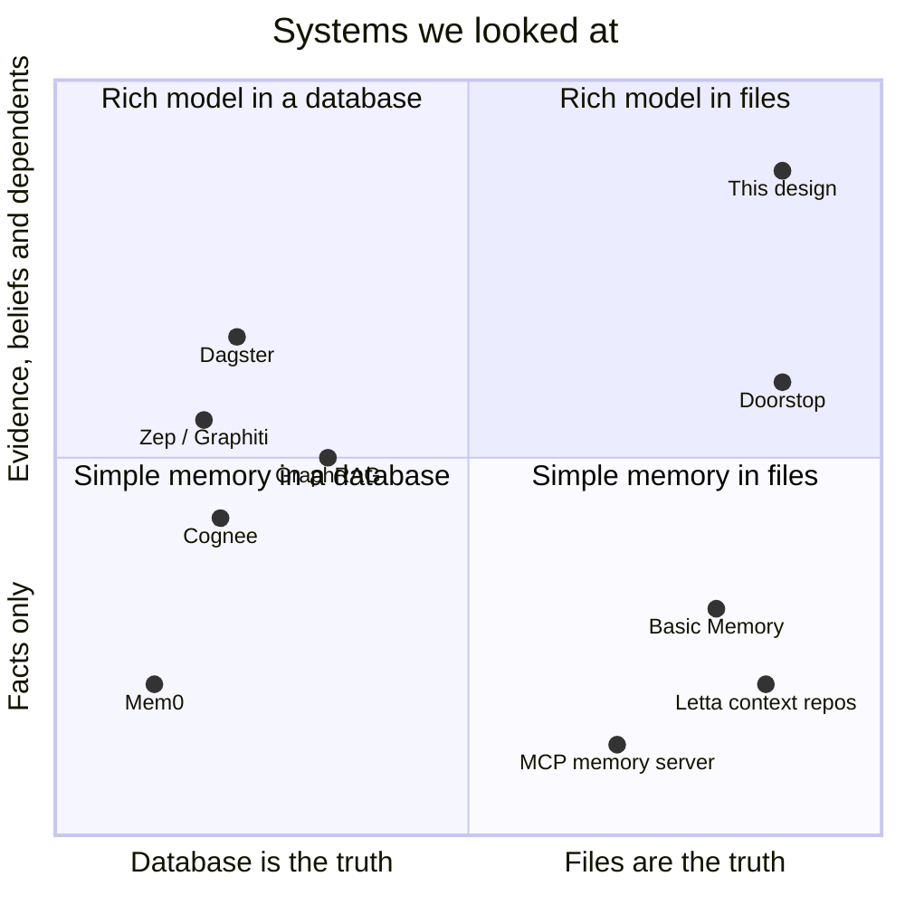

# Context graph design, part 2: the landscape

## Why this exists

Part 1 defined a model: small, typed, linked records that separate **what we believe and why** from **what we chose to do**, and that know what to reopen when a belief turns out wrong. Before building it, we looked at how others solve the same problems.

This part is that map. Its value:

- **It shows where our design matches common practice**, so the parts that match can be built on with confidence and talked about in familiar terms.
- **It shows what we chose not to use, and why**, so the choice can be revisited when the facts change instead of being argued again from scratch.
- **It names what we borrowed**, so credit and further reading are one step away.
- **It marks what has no precedent**, which is where the design is most likely to be wrong and most worth testing.

Part 3 turns these choices into an implementation design: the files, the index, and how today's initiative folders move onto the model.

**How to read this.** Section 1 lists the questions we took to the landscape, and section 2 places everything we looked at on one picture. Sections 3–6 cover storage, the index engine, agent-memory systems and data lineage tools, each ending with what we chose. Section 7 recaps the older ideas behind part 1. Section 8 marks what is new, section 9 collects pitfalls others hit, and section 10 lists what can safely come later.

## 1. The questions

| Question | Why it matters |
|---|---|
| Where does the truth live: in files or in a database? | Decides whether records can be read, reviewed and merged like code, and what happens when a tool is abandoned. |
| What indexes the records for fast questions? | Agents need "what relies on this?" and "find the belief about X" without reading every file. |
| How do agent-memory systems store facts, handle contradictions, and keep sources? | They are the closest products to what we're building, and they are moving fast. |
| How do data pipelines decide what needs rebuilding when an input changes? | The same problem as staleness, solved at scale in production. |
| How do other fields notice that something built on a wrong fact needs revisiting? | Part 1's invalidation and staleness rules are the heart of the design. |

## 2. Where everything sits

Two questions separate the systems we looked at: **is the truth kept in plain files or in a database**, and **how much does the system know about why something is believed and what depends on it**.

**Walk-through.** Most agent-memory products sit on the left: a database holds the truth, and facts are extracted automatically. The right side is newer and growing: Letta and Basic Memory both moved to markdown files in git. Higher up, systems record more about *why*: Graphiti marks a contradicted fact as invalid instead of deleting it, GraphRAG tags claims as true, false or suspected, Doorstop (a requirements tool, not an agent product) tracks which linked items need re-checking, and Dagster (a data pipeline tool) records exactly which version of each input every output was built from. Nothing we found sits in the top right with us: files as the truth, with evidence, beliefs, and the commitments that rely on them.

## 3. Where the truth lives

| Approach | Who does it | What it gives | What it costs |
|---|---|---|---|
| **Markdown files in git, with a rebuildable index** | Basic Memory; Letta context repositories (2026); Doorstop (requirements); Anthropic's memory tool (files on the client) | Readable in any editor; diffs and review like code; history for free; the index can be deleted and rebuilt; survives any tool being abandoned | The index must be kept in step with the files; querying needs the index |
| One shared file for all records | The reference knowledge-graph memory server for MCP (Model Context Protocol) | Simplest possible | Every write touches the same file; it needed cross-process locks and stale-lock recovery |
| A database as the truth | Mem0, Cognee, Zep, GraphRAG's tables | Fast queries; mature retrieval | Not reviewable like code; several stores (vector, graph, relational) can drift apart; abandoned engines strand the data |

**What we chose: one markdown file per record, in git, with a rebuildable index.** Each record's structured fields go in a short header (YAML frontmatter); prose goes in the body. Parallel agents almost never touch the same file, so merges stay clean. This is where Letta landed independently in 2026, down to auto-committing every change and giving each subagent its own git worktree. Basic Memory is the closest match overall: markdown in git, a SQLite index with full-text search, and tools for agents to search and traverse.

**The overlap is strong enough to say plainly: the storage layer is not novel.** That is good news. It means the risky parts of the design are elsewhere.

**Our own write-ups stay whole.** A survey or analysis we write is a `finding`: one document, revisable, with only its load-bearing beliefs pulled out as records. Letta and Basic Memory keep documents whole in the same way; most products in section 5 extract facts and keep the document only as raw input.

**How strict the headers are.** Three common answers:

| Approach | Who does it | Verdict |
|---|---|---|
| Strict fields, plus a free-form area for anything else | Kubernetes (fixed fields beside free-form labels and annotations); OpenAPI (extension fields starting with `x-`) | **Chosen.** An unknown field is an error with a "did you mean" suggestion; new or local fields go under `extra:` until promoted |
| Accept anything, warn on unknown fields | Hugo and Jekyll front matter | Passed. A typo in a link name silently drops a dependency, and warnings that are usually harmless get ignored |
| Strict, no free-form area | Our schemas until now | Passed. Blocks experiments, and anyone sharing the toolkit would have to fork the schemas |

Kubernetes offers the same three as a per-request setting (Strict, Warn, Ignore).

## 4. What indexes the records

The index answers three kinds of question: walking links ("everything that relies on this belief, transitively"), finding records from plain words, and later, search by meaning. At a few hundred records, speed is not the issue. Long-term maintenance was the deciding criterion, because the engine first considered was abandoned.

| Engine | Kind | Status (late 2026) | Verdict |
|---|---|---|---|
| **SQLite** | Embedded relational database | Maintained for decades; built into most languages, and embeddable in Go without a C compiler | **Chosen** (a leaning). Recursive queries walk links; FTS5 (its full-text search) finds records from words; `sqlite-vec` adds search by meaning later |
| DuckDB | Embedded analytics database | Maintained | Passed. An extra dependency; its strength is large-scale analytics; its graph-query extension is still research-stage |
| Kùzu | Embedded graph database (Cypher queries) | Archived October 2025; forks LadybugDB and RyuGraph continue | Passed. The abandonment is exactly the risk files-as-truth guards against |
| CozoDB | Embedded graph database (Datalog queries) | Last release v0.7; little recent activity | Passed. A new query language with an uncertain future |
| Oxigraph | Embedded RDF store (W3C's subject–predicate–object format, SPARQL queries) | Maintained | Passed for the index; a good fit for a later export to the W3C provenance standard |
| Plain code, no database | In-memory | n/a | Passed. Every agent question becomes a script |
| Neo4j, Memgraph, FalkorDB, Apache AGE, TerminusDB | Database servers | Various | Ruled out: each needs a running server |

The index stores every record in one `nodes` table and every link in one `edges` table, instead of a table per record type. A new type or link is then new rows, not a schema change, which fits part 1's "grow by addition".

**Overlap:** Basic Memory uses the same engine for the same reasons. Mem0 removed four external graph-database backends from its open-source library in 2026, and Cognee warns its embedded graph store is unsafe with several agents at once. The trend is away from graph databases for this job.

## 5. Agent-memory systems

These products give AI agents memory that lasts across sessions. They are the closest relatives of this design, so we surveyed the strongest ones (versions as of late 2026).

| System | What it stores | When facts conflict | Keeps the source? |
|---|---|---|---|
| Mem0 | Short natural-language memories | Since April 2026: **adds only**, never overwrites or deletes; conflicts are left to retrieval | Partly (who said it, when) |
| Zep and Graphiti | Raw episodes, plus facts as links between entities | The newer fact wins; the old one is marked invalid with a date, never deleted | Yes, both directions |
| Letta | Markdown files in git | Ordinary edits and git merges | Git history only |
| Cognee | A typed graph of documents, chunks and entities | Not documented | Yes: every node stamped with the run that made it |
| GraphRAG (Microsoft) | Entities, relations, and claims marked true, false or suspected | No per-fact handling | Yes: claims keep the verbatim source text |
| LangMem | Collections of small memories, or one profile document | A model decides to update or delete | No |
| A-MEM (research) | Linked notes | A new note can rewrite older ones | Timestamp only |
| MCP memory server | Entities, observations, relations | Hard deletes | No |

### What the research says
- **Adding beats editing.** Mem0's 2025 design had a model decide per fact whether to add, update or delete. Its 2026 design only adds, and the vendor reports large gains on two public benchmarks.
- **Chains of conflicting facts defeat everyone.** In MemoryAgentBench, a 2025 benchmark, no system scored above 28% when a conflict had to be followed through several linked facts. Mem0 scored 2% and Zep 3%.
- **Benchmarks are contested.** Vendors dispute each other's setups, and a plain file-based agent did well on one popular benchmark. Treat headline numbers as marketing.

### What we borrowed
| Idea | From | How it shows up here |
|---|---|---|
| Never edit or delete the raw record; judge higher up | Mem0's switch to add-only | Evidence never changes; reconciliation happens in beliefs and their status |
| Write dependency links down; don't make a model infer them | The multi-hop failures above | Commitments name the beliefs they rely on, and the index walks those links |
| Store a link once and derive the reverse | Zep, GraphRAG | "What rests on this evidence?" is one index query |
| A contradicted fact stays visible, marked | Graphiti | A belief shown wrong is marked `incorrect`, not deleted |
| Never cap the list of sources | LightRAG, which caps it and loses traceability | A belief keeps every support link |
| Agents propose, people decide, on contradictions | Model-only checks are inconsistent and mostly wrong on chains | An agent's contradiction finding is a proposal until confirmed |
| A small always-loaded set, plus a browsable tree opened on demand | Letta | How context will be assembled per reader (a later part) |
| Each type declares which fields make two records "the same" | Cognee, Zep | Catches duplicate sources before they spread |
| Our own small test set for updates and "I don't know" | LongMemEval, MemoryAgentBench | After a belief turns `incorrect`, does the agent stop using it? When support is thin, does it say so? |

### Where we deliberately differ
- **Recorded, not extracted.** These systems extract facts from every conversation. We record evidence word for word and pull out only the beliefs that carry weight.
- **Recency isn't truth.** Most let the newest fact win. Here a belief falls only when something argues it is false.
- **Work is part of the graph.** None of them has decisions, designs, tasks or plans, so none can say what a wrong fact affects.
- **Words before vectors.** Every product leans on embeddings. We start with full-text search and add vectors only if needed.

## 6. Data lineage tools

Data pipelines face part 1's staleness problem at scale: when an input changes, which outputs need rebuilding, without rebuilding everything? We surveyed the strongest tools (late 2026).

| Tool | How it knows what an output came from | How it decides something is stale | How it stays quiet |
|---|---|---|---|
| OpenLineage, with Marquez | Each run reports the datasets it read and wrote | It doesn't: it records what happened | n/a |
| dbt | Dependencies declared in code | Compares the project with a saved copy of a previous one, aspect by aspect | Tags and descriptions never count as changes; contracts separate breaking from non-breaking changes |
| **Dagster** | Every output stores the version of each input it was built from | Per link: an input's current version differs from the one recorded. **Never marked down a whole chain** | A grandchild turns stale only if its parent is rebuilt and actually comes out different; code can declare an output unchanged |
| SQLMesh | Fingerprints of each model and its parents | A change is breaking or non-breaking | Non-breaking changes rebuild only the changed model; when unsure, the cautious choice wins |
| DataHub | Lineage stored on the downstream item, reverse derived | No version-based staleness | A time filter hides old links |

Dagster is the closest match. Its record of "built from this version of that input" is almost exactly part 1's pinned link.

### What we borrowed
| Idea | From | How it shows up here |
|---|---|---|
| Staleness is worked out per link, never stored, never marked down a chain | Dagster | A record is stale when a link's pinned fingerprint differs from the target's; early cutoff comes for free |
| A re-check can declare "still holds" | Dagster (code supplies its own version); SQLMesh (a person marks a change non-breaking) | A re-check re-pins without a new revision. This matters more for us than for them: an agent re-deriving a record almost never produces identical text |
| Each change says whether it's breaking | SQLMesh; dbt contracts | Revisions are `breaking` or `non_breaking`; unknown means breaking |
| Keep the comparison base safe | dbt, which can overwrite its own saved state | Pins and re-check results live in the record files, never only in the index |
| Changing how fingerprints are computed must not look like everything changed | Our reading of dbt's false positives | The fingerprint method carries a version |
| Store the link on the downstream record, derive the reverse | DataHub, Dagster | Confirms part 1's "store each relation once" |

### Where we deliberately differ
- **They track change, not truth.** No lineage tool can say an input was shown false. Invalidation travelling up has no counterpart there.
- **Rebuilding is cheap and exact for them, expensive and fuzzy for us.** Theirs is a query; ours is an agent's or a person's judgement. So we pin only load-bearing links, while they record every input.
- **Scale and schedules.** They handle millions of assets on timers; we have hundreds of records that change on events.

## 7. Older ideas behind part 1

Part 1's rules for invalidation and staleness come from fields much older than agent memory. In brief:

| Field | Idea | Where it shows up |
|---|---|---|
| Truth maintenance systems (1979, 1986) | A conclusion falls only if all its reasons fall; record which assumptions each conclusion holds under | Only a change to a named load-bearing belief reopens a commitment |
| Argumentation (defeaters) | Rebutting (the claim is false) differs from undermining the evidence or undercutting the reasoning | Only a rebut makes a belief `incorrect`; the others trigger a re-check |
| Build systems | Rebuild when inputs change, but stop if a rebuilt result is unchanged ("early cutoff") | Staleness stops spreading when a re-check shows a record still holds |
| Requirements traceability | A change at either end of a link marks it "suspect" until a person clears it | The warning: flag fatigue. The design must stay quiet |
| W3C provenance standard (PROV) | Entities, activities and agents; derivation and revision | The backbone of the knowing layer |
| Beliefs, desires and intentions (BDI) agents | Commitments resist reconsideration | Commitments are stable unless a belief they rest on changes |

## 8. What is new here

We found no precedent, in agent memory or elsewhere, for the combination of:

- **Evidence and beliefs as separate records**, with support links that can be rebutted, undermined or undercut, **inside an agent's working memory**.
- **Invalidation that travels up to commitments.** Graphiti invalidates a contradicted fact and stops; nothing re-checks what was built on it. Data lineage tools carry change downward, but have no notion of an input being false.
- **Authors naming load-bearing beliefs** when they write a commitment, instead of the system inferring dependencies.
- **Quietness as a primary design constraint**, with agent triage and ranked digests instead of flags.

These are the parts most worth testing early, with the small scenario set from section 5.

## 9. Pitfalls others hit

1. **Silent destructive writes** lose what was believed before (Mem0's old deletes, A-MEM rewriting notes, hard deletes in the MCP server).
2. **One file for every write** needs locks and still breaks under parallel agents.
3. **Several stores of truth drift apart.**
4. **Capped sources** make facts untraceable.
5. **Model-only contradiction checks** are inconsistent; use them to propose, not decide.
6. **Unmeasured benchmark claims.** Measure our own scenarios instead.
7. **Abandoned engines.** Keep the truth somewhere that outlives any tool.
8. **Flag fatigue.** A stream of "suspect" flags gets bulk-cleared and ignored.
9. **Marking a whole chain stale** floods everything below a change; Dagster deliberately works one link at a time.
10. **Versions that include the run** make every run look like a change (Marquez, and Dagster's fallback). Pin on content, never on which run produced it.
11. **State kept only in a rebuildable store** is lost on rebuild (dbt overwriting its saved state).

## 10. Can safely come later

None of these blocks part 3. Each can be settled or added later without rewriting records.

- **Recording the engine choice as a decision.** SQLite is a leaning. It is safe to hold because the index is rebuilt from the files: switching engines costs a rebuild, not a migration.
- **The decision lifecycle and ADR tooling.** The formats of architecture decision records (ADRs) and MADR are already borrowed (part 1). Their lifecycle in practice (which status changes are allowed, who makes them, what prompts a re-check) and the tools around them are left to a separate initiative, decision-records. Part 3 needs only the list of statuses, which part 1 has.
- **The deferred ideas from data lineage:** pinning a section of a long record, a second fingerprint for metadata, grouping stale records by root cause, staleness from age, and noting who made each link. Part 1, section 8 lists each where it fits.
- **Unverified survey details:** the internals of Mem0's hosted graph, whether Cognee handles contradictions, and the details of the benchmark disputes. We borrow ideas, not products, so none of them changes the design.

## Coming in later parts

- **Part 3, the implementation design:** the files and folders, what goes in a record's header and body (and the strict-plus-`extra:` schemas), how revisions, pins and re-check results live in a file, how fingerprints are computed, the SQLite index and its queries, and how today's initiative folders migrate.
- **Assembling context per reader:** what each reader sees at each moment, using the two-tier pattern above.
