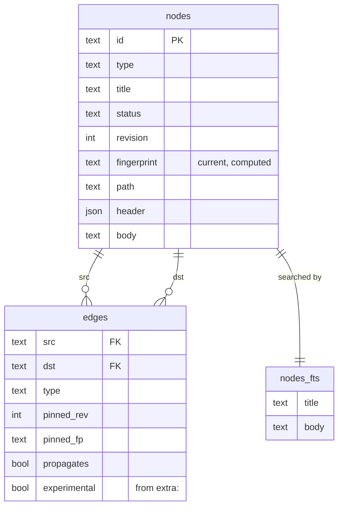

# Context graph design, part 3: the implementation

## Why this exists

Part 1 defined the model: small, typed, linked records that separate what we believe and why from what we chose to do, and that know what to reopen when a belief turns out wrong. Part 2 compared it with how others solve the same problems. This part turns the model into something a tool can store, check and query.

Its value:

- **Records stay plain files.** They can be read in an editor, reviewed in a pull request and merged like code. The tool can be thrown away and the knowledge stays.
- **Mistakes are caught when they're written.** A misspelt field or edge is an error with a suggested fix, so a dependency can't silently go missing.
- **Staleness is a query, not a chore.** Every link remembers what it was built against. Asking "what needs a re-check?" is one lookup, and the answer is the same every time the index is rebuilt.
- **Drafting stays cheap.** A record can change freely until something is built on it. Only then do its changes start to matter.
- **There's a path from today's folders.** Each kind of record in today's initiative folders has a place to go, and initiatives can move one at a time.

**How to read this.** Section 1 shows the layout of a workspace. Sections 2–3 cover what a record file looks like and how its fields are checked. Sections 4–5 cover links, pins, revisions and fingerprints, which are the heart of this part. Section 6 is the index and its queries, and section 7 the generated pages. Section 8 covers moving today's initiatives over, and section 9 traces one change end to end. Section 10 lists what can safely come later. Commands are written as `mason <command>`.

## 1. The layout

```
workspace/
├── .loremason/
│   ├── config.yaml        # which loremason version this workspace uses
│   ├── .gitignore         # ignores index.db
│   └── index.db           # the SQLite index, rebuilt from graph/
├── graph/
│   ├── belief/
│   │   └── bel_7k3m9q.md
│   ├── evidence/
│   │   └── ev_p4n2xa.md
│   ├── design-doc/
│   │   └── dd_c5r1tw.md
│   └── …                  # one folder per record type
└── initiatives/
    └── search-redesign/
        └── README.md      # generated, never edited by hand
```

- **`.loremason/` marks the workspace.** Tools find the workspace by walking up from the current folder until they see it, the way git finds `.git`. An environment variable can point at a workspace explicitly. The same folder holds the pinned version and the index, so one marker does three jobs.
- **`graph/` holds every record**, one file each, in one folder per record type. The folder name is the type in kebab-case: `design_doc` records live in `design-doc/`. The graph is shared by the whole workspace. Records aren't filed under an initiative, because knowledge outlives the effort that formed it (part 1, section 3.4).
- **Filenames are the ID only.** A filename built from the title would go stale whenever a revision changed the wording.
- **`initiatives/` holds generated pages**, so browsing an initiative on GitHub still starts at `initiatives/<name>/README.md` (section 7).
- **`index.db` is never committed.** The files are the truth, and any tool can rebuild the index from them.

### IDs

An ID is a short type prefix, an underscore, and six random characters. The characters come from a 32-letter alphabet of digits and lowercase letters, without `i`, `l`, `o` and `u` so that IDs can't be misread. That gives about a billion IDs per type, generated without coordination.

| Type | Prefix | Type | Prefix |
|---|---|---|---|
| `actor` | `who_` | `initiative` | `ini_` |
| `artifact` | `art_` | `prd` | `prd_` |
| `activity` | `actv_` | `requirement` | `req_` |
| `evidence` | `ev_` | `decision` | `dec_` |
| `belief` | `bel_` | `design_doc` | `dd_` |
| `finding` | `fnd_` | `task` | `task_` |
| `question` | `q_` | `plan` / `step` | `plan_` / `step_` |

Sub-records add a slash and a local part: `bel_7k3m9q/s1` is a support link and `q_3fz8km/o1` an option. A revision adds `@`, as in `plan_k2x8wd@r2`.

Steps are records of their own rather than sub-records of their plan. That's what lets a step keep its ID across plan revisions and be re-pinned or revised on its own (part 1, section 5).

## 2. Anatomy of a record

Every record is a markdown file that opens with a YAML header (between `---` lines). **The header holds everything a tool reads; the body holds what a person reads.** Tools never parse the body. They only fingerprint it (section 5). When a tool updates a header, it rewrites only the fields it owns (link lists and `revisions`) and leaves every other line exactly as written, comments and spacing included.

A belief:

```markdown
---
id: bel_7k3m9q
title: validate doesn't handle non-UTF-8 input
claim: validate doesn't handle non-UTF-8 input
status: held
asserted_by: agent
support:
  - {id: s1, evidence: ev_p4n2xa, direction: supports}
  - {id: s2, evidence: ev_h8c1rt, direction: supports}
created: 2026-11-22
---

Both failures are on files that aren't UTF-8 (one Latin-1, one
UTF-16), and both fail at the same read call.
```

A task, with a link pinned to that belief:

```markdown
---
id: task_9w4hzd
title: Report unreadable files clearly
status: accepted
part_of: ini_2m8vqe
implements:
  - {to: req_5txk3a, rev: 1, fp: "fp1:7d0e2a91c4b3"}
derived_from:
  - {to: dd_c5r1tw, rev: 2, fp: "fp1:e81f5530a2d9"}
relies_on:
  - {to: bel_7k3m9q, rev: 1, fp: "fp1:3a9c0e1b77d2"}
created: 2026-11-22
---

## Outcome
validate names any file it can't read and the encoding it expected,
then carries on with the rest.

## Approach
…
```

Fields every record has:

| Field | Meaning |
|---|---|
| `id` | Must match the filename. The type comes from the prefix, so there's no `type` field. |
| `title` | One line a person sees wherever the ID appears. |
| `created` | Date written. When it last changed comes from git. |
| `aliases` | Optional. Other names that resolve to this record, such as an ID from before migration (section 8). |
| `revisions` | On revisable types only (section 5). |
| `extra` | Optional. A free-form area for anything the schema doesn't know yet (section 3). |

Type-specific fields follow the model in part 1. Edges are fields named after the edge, such as `relies_on` or `part_of`, on the record that makes the claim. Sub-records, such as a belief's `support` list or a question's `options`, are lists inside their parent's header, each entry with its own short `id`.

Some types put their main content in the body:

| Type | What the body holds |
|---|---|
| `evidence` | The verbatim quote or observation. Never edited. |
| `finding`, `design_doc`, `prd` | The document itself. |
| `task`, `plan`, `step` | Outcome, approach, the exact instructions. |
| `belief`, `decision`, `question` | Optional reasoning. The claim, choice and wording are header fields. |
| `initiative` | Purpose and goals. |

## 3. Schemas

Each record type has a schema, written in JSON Schema (a widely used standard for describing the shape of JSON and YAML data). Alongside the schemas, a small **type registry** (`types.yaml`) records what JSON Schema can't express:

```yaml
belief:
  prefix: bel
  layer: knowing
  revisable: true
  revisions_inline: true      # keep old wording in the file (section 5)
  meaning: [claim]            # fields that are fingerprinted
  identity: [claim]           # fields that suggest a duplicate
  edges:
    answers: {to: [question], propagates: false}
task:
  prefix: task
  layer: committing
  revisable: true
  revisions_inline: false
  meaning: [title, body]
  edges:
    part_of:      {to: [initiative], propagates: false}
    implements:   {to: [requirement], propagates: true, pinned: true}
    derived_from: {to: [design_doc], propagates: true, pinned: true}
    relies_on:    {to: [belief], propagates: true, pinned: true}
```

- **Meaning fields** are the ones a fingerprint covers (section 5).
- **Identity fields** let `validate` warn that a new record looks like an existing one and suggest using that instead. This mainly helps sources: two `artifact` records with the same URL are probably the same thing.
- **`propagates`** says whether a change in the target means this record needs a re-check. Part 1, section 3.2 lists those edges. Writing it down per edge type is how the "per-edge propagation" in part 1, section 8 starts.

**Strict fields, plus a free-form area.** A field the schema doesn't list is an error, and `validate` suggests the closest known one ("unknown field `relies_om`; did you mean `relies_on`?"). Edge names follow the same rule. Anything can go under `extra:` without being checked:

```yaml
extra:
  confidence: 0.7               # an experiment; not part of the schema yet
  inspired_by: [fnd_a1b2c3]     # an experimental edge: indexed, never propagates
```

A field that proves useful is promoted into the schema later. That's an addition, so records already written stay valid. Edges under `extra:` show up in queries but never carry staleness or invalidation, which keeps propagation predictable.

Why strict: a warning lets a typo such as `relies_om` silently drop a dependency, and then invalidation never reaches that record. Warnings that are usually harmless also teach people to ignore them. The free-form area keeps experiments possible without forking the schemas. Kubernetes works the same way, with strict fields beside free-form labels and annotations.

## 4. Links and pins

A link appears in one of two forms:

| Form | Written as | Used for |
|---|---|---|
| **Bare** | `relies_on: [bel_7k3m9q]` | What a person or agent writes. Also every link that doesn't propagate (`part_of` an initiative, `mentions`, `answers`). |
| **Pinned** | `{to: bel_7k3m9q, rev: 1, fp: "fp1:3a9c0e1b77d2"}` | What a link that propagates becomes. It records the target's revision and fingerprint at the moment the link was made or last checked. |

**People never type fingerprints.** They write bare links, and `mason sync` pins each new link that propagates to its target's current state. A bare link that propagates is valid but not yet watched, so it can never be stale. `mason sync` runs as part of the skills that write records, so in practice links are pinned within the same change.

A pinned link can carry one more field: `via: ev_…`. It names the evidence recording the last re-check that concluded "still holds" (section 5), so the reason for a re-pin is one click away.

Some edges never propagate. `part_of` to an initiative, `involves`, `interested_in`, `answers` and `mentions` are always bare. Evidence `from` a finding is pinned, so the quote can always be traced to the exact revision it came from, but it doesn't propagate: revising a finding doesn't make its old quotes wrong.

## 5. Revisions, fingerprints and re-checks

### Revisions in the file

A revisable record (beliefs, questions, findings and every commitment) keeps a `revisions` list in its header. The last entry is the current revision:

```yaml
revisions:
  - rev: 1
    date: 2026-11-22
    fp: "fp1:3a9c0e1b77d2"
    claim: validate doesn't handle non-UTF-8 input    # old wording, kept inline
  - rev: 2
    date: 2026-11-29
    fp: "fp1:91bd04e6c2a8"
    change: breaking
```

- **`change`** says whether the revision is `breaking` or `non_breaking` compared with the one before. If it's left out, the revision counts as breaking. Removing or narrowing something is breaking; adding something isn't.
- **Old text is kept inline for short records** (beliefs, questions, requirements, steps), so a reference to `@r1` can be read without git.
- **For long documents, the old text stays in git.** That covers findings, design docs, PRDs, tasks, plans and decisions. Their entries hold a `commit` instead of the old text, so a file doesn't fill up with old drafts. Staleness never needs the old text, only the fingerprints, which are always in the file.
- **A record with no `revisions` list is at revision 1.** That's how a new record starts, so `@r1` can be named straight away. `mason sync` writes the entry, with its date and fingerprint.

### Drafting stays cheap: a revision is sealed when something pins it

Until another record pins a revision, it can be edited freely. `mason sync` keeps its recorded fingerprint up to date, and no new revision is made.

**The first pin seals the revision.** After that, a change of substance needs a new revision. **The revision comes first, then the edit:**

1. `mason revise <id> --breaking` (or `--non-breaking`) keeps the current wording inline, or for long records the commit that holds it, and opens the next revision. It needs one of the two flags, so an agent never meets a prompt.
2. Edit the record.
3. `mason sync` records the new revision's fingerprint, since nothing pins it yet.

Doing it in that order means the old wording is always still in the file when it's kept, with no need for git. If someone changes a sealed record's substance without a revision, `validate` fails and says to undo the change, run `mason revise`, then make it again. `revise` refuses to run in that state, so the changed wording can't be kept by mistake as the old one.

This is what keeps the structure out of the way while ideas are forming. A design doc, finding or plan can go through many drafts in a day. Revisions only start once other work is built on it.

Status changes and new support links are never substance. They're edited in place, and git keeps their history.

### Fingerprints

A fingerprint is a short code computed from a record's meaning fields. If the fingerprint is unchanged, the meaning is unchanged. Formatting edits leave it alone, so they never raise staleness.

```
fp1:3a9c0e1b77d2
└┬┘ └─────┬────┘
 │        └ first 12 hex characters of a SHA-256 hash of the canonical form
 └ the method's version
```

The **canonical form** is fixed precisely, because any drift would look like every record changing:

1. Take the record's meaning fields from the registry. `body` stands for the body.
2. Write the fields as compact JSON with sorted keys, in UTF-8. Characters are written as themselves, except what JSON itself requires to be escaped (quotes, backslashes, control characters) and the line and paragraph separators U+2028 and U+2029, written as `\u2028` and `\u2029`. `<`, `>` and `&` are written as themselves.
3. Normalise the body: Windows line endings (`\r\n`) become Unix ones, trailing spaces and tabs are removed from each line, runs of blank lines become one, and blank lines at the start and end are dropped. A line holding only spaces counts as blank. A lone `\r` is left as it is.
4. Write IDs inside fields bare, without `@rN`.
5. Hash the result with SHA-256 and keep the first 12 hex characters.

The `fp1:` prefix names the method. If the method changes, say to stop counting markdown formatting as change, it becomes `fp2:`, and tools compare like with like. They never read a method change as every record changing.

### Re-checks

When a pinned link no longer matches its target, the record holding it is stale. An agent re-checks it and ends in one of two ways:

| Outcome | What changes on disk |
|---|---|
| **Still holds** | The pin is updated to the target's current revision and fingerprint, with `via` pointing at a new evidence record that says why (`about` the record, `generated_by` the agent's session). The record itself gets no new revision, so nothing below it is touched. That's early cutoff. |
| **Needs to change** | The record gets a new revision through `mason revise`, and its pins are updated. Whatever pins *it* now becomes stale, one step further down. |

**Non-breaking revisions re-pin quietly.** If every revision between a pin and its target's current one is `non_breaking`, `mason sync` moves the pin forward with no re-check and no evidence. The revision's own `change` value is the record of why, so a `via` from an earlier re-check is dropped.

Pins, `via` links and re-check evidence all live in record files, never only in the index. So a rebuild from the files always gives the same answer to "what is stale?".

## 6. The index

`index.db` is a SQLite database (a database kept in a single file). `mason` is written in Go and includes SQLite through a pure-Go driver, so it stays one binary with nothing else to install. The index is rebuilt from `graph/` whenever a query finds files newer than the last build. A full rebuild of 5,000 records took about a third of a second in a test, so there's no incremental update to get wrong.



- **`nodes`** has one row per record and sub-record. Sub-records such as `bel_7k3m9q/s1` get their own rows so that edges like `undercuts` can point at them.
- **`edges`** has one row per link, including links implied by containment (an option `part_of` its question). Reverse links aren't stored; a query reads `edges` from the other side.
- **`nodes_fts`** is SQLite's built-in full-text search (FTS5). It lets a person or agent find "the belief about non-UTF-8 files" from plain words.
- A **`meta`** table records the loremason version and the fingerprint method used to build the index.

Staleness falls out of a join:

```sql
-- every pinned link whose target has moved on
SELECT e.src, e.dst, e.pinned_rev, n.revision
FROM edges e JOIN nodes n ON n.id = e.dst
WHERE e.propagates AND e.pinned_fp IS NOT NULL
  AND e.pinned_fp <> n.fingerprint;
```

Invalidation is a second query: commitments whose `relies_on` targets a belief that is `incorrect` or `insufficient`. Recursive queries (SQL's `WITH RECURSIVE`) are used only to explain, such as tracing a stale step back to the belief that started it. They're never used to mark a whole chain stale.

**Named queries** are the everyday interface, the same for people and agents:

| Command | Answers |
|---|---|
| `mason find <words>` | Which records match these words? Shows titles, types and statuses. |
| `mason show <id>` | One record, with every link shown as its title rather than its ID, and links pointing at it. |
| `mason dependents <id>` | What is built on this, directly and further down? |
| `mason stale` | Which links need a re-check, grouped by the record that changed? |
| `mason reopened` | Which commitments rely on a belief that has fallen? |
| `mason where <initiative>` | The "where are we" view: work in progress, open questions, recent decisions. |

Writing commands are kept separate and few. `mason new <type>` creates a record with a fresh ID, `mason revise <id>` makes a new revision, and `mason sync` fills pins, refreshes unsealed fingerprints, re-pins across non-breaking revisions and regenerates views. `validate` only reads, and fails on any error.

`mason sync` works in a fixed order, because a pin seals the revision it names: first it writes revision 1 where it's missing, then it records fingerprints of revisions nothing pins yet, then it pins bare links, then it re-pins across non-breaking revisions. It leaves a file with errors alone and says so, because re-writing a link list it can't read could lose what a person wrote. `mason sync --dry-run` says what it would do. Rewritten fields always take one form: links as a block list of `{to, rev, fp, via}` maps, revisions as a block list of maps. Every other line keeps its bytes, comments and spacing.

## 7. Generated pages

An initiative's pages are built from the records linked to it and written to `initiatives/<name>/`:

| Page | Contents |
|---|---|
| `README.md` | Title, purpose and goals from the `initiative` record. Who is involved and their roles. The initiative's design docs, PRD and tasks, each linked by title. |
| `where.md` | The `mason where` view: in progress, blocked, open questions, leanings waiting for a decision, anything stale or reopened. |

Each page opens with a line saying it's generated and from what. The pages are committed, so they read well on GitHub and in pull requests. `mason sync` regenerates them, and `validate` fails if one is out of date, so a hand edit can't quietly drift. The folder name comes from the initiative's `slug` field.

## 8. Moving today's initiatives

Before loremason, each initiative was a folder holding JSON logs, markdown findings, tasks, plans and a scratchpad. Here's where each part goes:

| Today | Becomes |
|---|---|
| `README.md`, `initiative.json` | An `initiative` record; the README is generated from now on. |
| `stakeholders.json` | `actor` records, with an `involves` link on the initiative carrying each role. |
| `questions.json` | `question` records, `part_of` the initiative. |
| `decisions.json` | `decision` records. Each decision's options move to the question it answers. Its free-text context becomes beliefs only where they're load-bearing; otherwise it stays as the decision's body. |
| `findings/` | `finding` records with their prose unchanged, plus an `activity` for the session that wrote each one. |
| `tasks/`, `plans/` | `task` and `plan` records. Old plans keep their steps in the body; only new plans get `step` records. |
| `quizzes/` | An `artifact` for the conversation, plus evidence quoting the answers. |
| Scratchpad (`CONTEXT.md`) | Not migrated as a record. Its useful content becomes questions, beliefs or leanings by hand, and `where.md` replaces it. |

**Old IDs keep working.** Each migrated record lists its old ID in `aliases` (`search-redesign/F-002`). So old references in prose still resolve through `mason show`, and nothing has to be rewritten at once.

**One initiative at a time.** The old checker keeps validating the initiatives still in the old format, and the new tool validates `graph/`. The two run side by side, and the old checker retires when the last initiative moves. The first initiative to move is a pilot, ideally one doing open-ended design work. Moving it is also the test of whether this structure gets in the way of open-ended design work, or helps it.

The order of building, from an empty loremason repository to a working workspace, is a plan of its own, written after this part is agreed.

## 9. Worked example: a belief changes

The IDs follow part 1, section 5.

**1. Before.** The task above relies on `bel_7k3m9q@r1`. A plan, `plan_k2x8wd`, is `derived_from` the task at revision 1. Its three steps are each `part_of` the plan at revision 1. `mason stale` returns nothing.

**2. The belief is revised.** New evidence shows UTF-16 files are read fine and only Latin-1 fails. The claim narrows to "validate doesn't handle Latin-1 input". Narrowing a claim is breaking, so an agent runs `mason revise bel_7k3m9q --breaking`, which keeps the old wording inline as revision 1 and opens revision 2. Then it edits the claim and runs `mason sync`, which records revision 2's fingerprint.

**3. One link goes stale.**

```
$ mason stale
validate doesn't handle Latin-1 input  (belief, r1 → r2, breaking)
  └ Report unreadable files clearly  (task, accepted)
```

Only the task appears. The plan and steps aren't stale: their pins point at the task, and the task hasn't changed.

**4. The re-check stops early.** An agent re-reads the task against the new claim. Reporting unreadable files clearly is still the right outcome. The agent writes evidence `ev_m3q8vb` ("still holds: the outcome doesn't depend on which encodings fail") and moves the task's pin to `{to: bel_7k3m9q, rev: 2, fp: "fp1:91bd04e6c2a8", via: ev_m3q8vb}`. The task gets no new revision, so the plan is never touched.

**5. Had it gone the other way.** Say the task's approach named UTF-16 detection specifically. The agent revises the task (`task_9w4hzd@r2`, breaking). Now the plan's pin is stale, and the plan is re-checked. If its steps need to change, the plan gets a revision and each step is re-checked in turn. A step that still holds re-pins and stops.

**6. Had the change been cosmetic.** If someone only re-wrapped the belief's reasoning, its meaning fields wouldn't change, so neither would its fingerprint. Nothing would be stale, and no revision would be needed.

At no point did a person see a flag. This example leaves out part 1's decision, which also relies on the belief. Its link would go stale in step 3 as well, and because the decision is `accepted`, its re-check would come to a person as a drafted change, never as a bare warning (part 1, section 4).

This walk-through runs as tests (`cmd/mason/belief_change_test.go`).

## 10. Can safely come later

None of these changes the file format. Each can be added without rewriting records.

- **An MCP (Model Context Protocol) server**, so agents can call the named queries as tools rather than through the command line. Basic Memory is the model to learn from.
- **Hybrid search**, adding vector search (`sqlite-vec`) beside full-text search.
- **Incremental index updates**, if full rebuilds ever get slow.
- **Whether `validate` becomes `mason validate`.**
- **The ideas part 1, section 8 already lists:** pinning a section of a long record and quote selectors, a second fingerprint for metadata, recording who made each link, more run fields, the initiative lifecycle, ownership, and grouping stale records by root cause.
- **A PROV export**, writing the graph out in the W3C provenance standard's own format, for example through Oxigraph.

## Coming in later parts

- **Assembling context per reader:** which records each reader gets at each moment, and which they must not see, built on `mason show`, `mason where` and the two-tier pattern from part 2.
- **The build plan** (not a design part): building the new tool up step by step in the loremason repository, then moving initiatives onto it, starting with a pilot.

## Appendix: Terms new in this part

| Term | Plain meaning |
|---|---|
| **header** | The YAML block at the top of a record file. Everything a tool reads. |
| **type registry** | `types.yaml`: per record type, its ID prefix, meaning and identity fields, and which edges propagate. |
| **meaning fields** | The fields a fingerprint covers. A change elsewhere is formatting or metadata. |
| **identity fields** | Fields that suggest two records are the same thing, such as an artifact's URL. |
| **bare link / pinned link** | A link as written, or with the target's revision and fingerprint recorded. |
| **sealed** | A revision that something has pinned. From then on, a change of substance needs a new revision. |
| **canonical form** | The exact text a fingerprint is computed from, fixed so that the same meaning always gives the same fingerprint. |
| **`via`** | On a pinned link: the evidence recording the re-check that last re-pinned it. |
| **generated page** | A page built from records, committed, and never edited by hand. |
| **alias** | Another name for a record, such as its ID before migration. |

